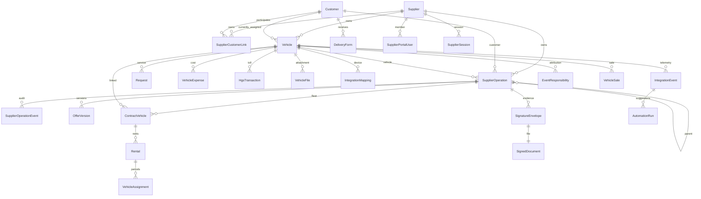

# Tedarikçi operasyon ürünü — ürün ve veri planı

14 Ekim 2026 · Kaynak: kullanıcının 14 ekran referansı. Görsellerdeki rakamlar, kişi/firma isimleri ve araç fotoğrafları örnektir; uygulamaya örnek veri olarak aktarılmaz.

## Ürün hedefi

Kiralama tedarikçisi kendi envanterini, müşteri ilişkilerini ve teklif → sözleşme → teslimat → kiralama → fatura/tahsilat zincirini tek çalışma alanında yönetir. Müşteri ekranı aynı Vehicle, Customer, Request, VehicleFile, VehicleExpense, HgsTransaction ve DeliveryForm kayıtlarını okur. Bir araç eklemek müşteriye atamak veya teslim etmek anlamına gelmez.

## Referansların ürün karşılığı

| Görsel / dosya saati | Ekran | Kullanıcının kararı | Verinin kaynağı / oluşması |
|---|---|---|---|
| 13.39.02 | Ana sayfa | Bugün hangi iş önce yapılmalı? | Envanter, işlem durumu, yaklaşan gerçek tarihler, gerçekleşmiş gider ve gelir |
| 13.39.03 | Araçlar | Araç havuzda mı, kirada mı, serviste mi? | Paylaşılan Vehicle; müşteri ataması ve operasyon durumu ayrı boyutlar |
| 13.39.03 (1) | Kiralamalar | Aktif kullanım ve bitişleri izle | Aktif sözleşme + tamamlanmış teslimat; kira tutarı ve limitler sözleşmeden |
| 13.39.04 | HGS | Etiket, bakiye ve geçiş yönet | Vehicle.hgs_* + HgsTransaction; yükleme gider sayılmaz, geçiş sayılır |
| 13.39.04 (1) | Müşteriler | İlişki ve araçlarını yönet | SupplierCustomerLink + ortak Customer; araç/sözleşme/fatura üzerinden hesaplanan özet |
| 13.39.05 | Onay & Yetki | Hangi işlem onay bekliyor? | İşleme bağlı onay kaydı + sunucuda uygulanan kullanıcı rolü ve tutar eşiği |
| 13.39.05 (1) | Servis & Bakım | Yaklaşan bakımı planla | Vehicle.next_service_* + mevcut Request; servis firması tedarikçinin kendisinden ayrı |
| 13.39.06 | Sigorta & Kasko | Poliçeyi kaydet, süreyi izle | Araç bağlantılı poliçe; güncel poliçe numarası ve bitiş tarihi Vehicle'a yansır |
| 13.39.06 (1) | Sözleşmeler | Taslağı aktifleştir, sonlandır | Müşteri + araç + onaylı teklif bağlantılı sözleşme; durum geçişi denetimli |
| 13.39.07 | Kontrol & Tasarruf | Hangi gerçek kaydı incelemeliyim? | Yakıt/km, fatura no tekrarı, kira farkı, kullanım ve bakımdan açıklanabilir kurallar |
| 13.39.07 (1) | Planlama & Karar | Farklı filo varsayımlarını karşılaştır | Kullanıcının kaydettiği senaryo; mevcut filoyla matematiksel maliyet karşılaştırması |
| 13.39.08 | Teklifler | Müşteri teklifini oluştur, sözleşmeye çevir | Müşteri, araç, süre, miktar, fiyat; mevcut müşteri ihaleleri ayrı görünümde korunur |
| 13.39.08 (1) | Teslimatlar | Kontrol ve teslimi tamamla | Sözleşme + araç + alıcı + km + kontrol listesi; tamamlanınca DeliveryForm oluşur |
| 13.43.25 | Raporlar | Gelir/maliyet ve dağılımı analiz et | Aynı kayıtlardan tarih/müşteri/araç filtresiyle yeniden hesaplanan özet ve CSV |

Menüde görülen Lastik, Hasar/Kaza, TPC, Yakıt, Fatura, Muhasebe, Kullanıcılar ve Ayarlar da aynı tasarım dili ve kayıt bağlantılarıyla tamamlanır. Gerçek fotoğraf/belge VehicleFile'dan gelir. Dosya yoksa açık boş durum gösterilir.

## Roller ve deneyim

Yedi rol: şirket sahibi, filo yöneticisi, operasyon, finans, satış, teslimat ve görüntüleyici. Sunucu her işlem türünü ayrı denetler; rapor dışa aktarma ve belge indirme ayrıca kontrol edilir. Kullanıcı/entegrasyon ayarları ve manuel belge yükleme şirket sahibine aittir. Eski API yolları da gerçek oturum ve kaynak sahipliği doğrulamasına bağlandı. Başarılı ve reddedilen yanıtlar audit kaydı oluşturur.

Ortak kabuk: koyu sol menü, mavi birincil aksiyon, açık çalışma alanı; başlık → gerçek KPI → durum sekmeleri → filtre → sayfalı tablo → seçilen kaydın sağ detay paneli. Dar ekranda menü çekmece, kayıt detayları ayrı tam genişlik paneli olur. Global arama modülleri ve kayıtları aynı çalışma alanında arar. Oluşturma/düzenleme formları modüle özgü alanlar içerir; kaydedilmeyen veri KPI'ya girmez.

## Veri modeli ve bağlantı haritası

SupplierOperation ortak işlem başlığını (tür, numara, sahibi, müşteri, araç, üst kayıt, tutar, başlangıç/bitiş, durum, sürüm) normalleştirir. Modüle özgü detaylar sunucuda tür bazında doğrulanır. Tip, sahiplik ve iş geçişleri serbest JSON veya serbest durum değişikliği olarak kabul edilmez. SupplierOperationEvent işlem zaman çizelgesini saklar. Yeni tablolar mevcut kayıtları silmeden create_all ile eklenir; eski araç/sözleşme/poliçe alanları geçiş döneminde kaynak etiketiyle gösterilir.

### Oluşum ve yazma noktaları

1. Envanter ekleme mevcut ortak araç formuyla Vehicle üretir; customer_id boş kalır.
2. Müşteri oluşturma ortak Customer + tedarikçi ilişki kaydı üretir. Mevcut müşteri kendi hesabından tedarikçiyi yetkilendirir; tedarikçi başka müşteri kimliğini kendiliğinden bağlayamaz. Diğer tedarikçinin özel ilişki alanları okunmaz.
3. Teklif kaydetme henüz kiralama veya gelir oluşturmaz. Onaylı tekliften sözleşme taslağı tek bir bağlantıyla oluşturulur.
4. Sözleşme bir veya çok araç içerir. Sürümüne bağlı imzalı PDF üç tarafça teyit edilmeden aktifleşmez. Aktivasyon araç başına Rental ve tahsis dönemi oluşturur; araç bedelini ve güncel şartları ortak Vehicle alanlarına yansıtır.
5. Teslimat planlama aktif sözleşmeye bağlıdır. Tamamlama için alıcı, tarih, km, temel kontrol maddeleri ve iki firma tarafından teyitli sürüme bağlı PDF gerekir. Tamamlama ortak DeliveryForm oluşturur, Vehicle teslim bilgilerini ve kilometre geçmişini günceller. Tekrar tamamlama yeni form oluşturmaz.
6. Teslim edilmiş kiralama önce iade ve mutabakatla kapanır. İade teslim başlangıç durumunu okur, km/hasar/yakıt bedellerini hesaplar ve finans/sahip onayıyla havuz/servis/satışa yönlendirir. Teslim edilmemiş sözleşme sonlandırması bekleyen kiralamayı iptal eder. Gider müşterisi tarihli tahsis/sürücü kaydından bulunur; belirsizlikte inceleme kuyruğu kullanılır.
7. Poliçe güncel araç sigorta alanlarına; servis talebi mevcut Request'e; yakıt gerçek VehicleExpense'e; HGS hareketi HgsTransaction'a bağlanır. Finans ekranı bunları ikinci bir gider kaydı üretmeden okur.
8. Fatura kaydı sözleşme/müşteri/araç ve yön (gelir/gider), vade, numara, tutar içerir. Tahsilat/ödeme ayrı bağlı kayıt üretir. Bakiyeyi aşan veya iptal faturaya ödeme reddedilir.
9. Onay eşiğini aşan işlem aktifleştirilemez/tamamlanamaz; bağlı onay gerekir. Onay, başvurunun tutar ve sürümüne bağlıdır; değişiklik eski onayı geçersiz kılar.
10. Bakım önerisi doğrulanmış GPS kilometresinden bir kez üretilir; onay/servis/fatura/tamamlama zinciri sonraki bakım eşiğini günceller. Satış dosyası kiralama uygunluğunu kapatır ve kesin satıştan fatura taslağı oluşturur.
11. Rapor, kontrol ve planlama kalıcı işlem kaydı yaratmaz; raporlar gerçek defterden, senaryolar açık kullanıcı varsayımlarından oluşur.

## Hesaplama kuralları

- Kirada = aktif araç + tamamlanmış teslimat + aktif sözleşme; eski kayıtlar için aktif müşteri ataması kaynak etiketiyle kullanılır. Havuz = aktif ve atanmamış; serviste/kaza durumları önceliklidir. Satışta açıkça girilen araç operasyon etiketidir. Pasif = is_active=false.
- Gerçek gelir = kesilmiş/ödenmiş gelir faturası; tahsilat ayrı toplamdır. Aylık kira × süre sözleşme değeri/öngörüsüdür, gerçekleşmiş ciro değildir.
- Maliyet = VehicleExpense + tamamlanmış servis faturası + HGS geçişi + poliçe primi + hasar maliyeti + ceza; gider faturaları kaynak bağlantısıyla aynı gideri ikinci kez saymaz.
- HGS yüklemesi bakiye transferidir, HGS geçişi maliyettir. Tahsilat gelir faturasıyla ikinci kez ciroya eklenmez. Kaynak giderine bağlı kesilmiş gider faturası varsa rapor tutarı ve tarihi faturadan alınır; kaynak gider ayrıca sayılmaz.
- Filtre tarihleri işlem tarihine uygulanır; aktif filo ve müşteri sayıları mevcut anlık stoktur. Tarihsel kullanım eğrisi ancak tarihsel kayıt varsa çizilir; yoksa “veri yok”.
- Tasarruf tespitleri potansiyeldir; toplanan tutarlar gerçekleşmiş kazanç olarak gösterilmez. Dış piyasa/benchmark ve AI model çıktısı yoktur; kurallar ve kanıt kaydı görünür.
- Senaryo maliyeti = araç sayısı × kullanıcı tarafından girilen aylık birim maliyet × 12. Sonuç tahmindir; planlama kaydı otomatik araç çıkarmaz veya sözleşme yenilemez.

## Kabul kriterleri

- Yeni kayıtta sahiplik/bağlı araç/müşteri/üst işlem doğrulanır; başka tedarikçinin kayıtları okunamaz ve değiştirilemez.
- Her tablo gerçek kayıtlar, arama, durum/müşteri/tarih filtresi, sayfalama, CSV ve bağlantılı detay gösterir.
- Teklif → sözleşme → teslimat → müşteri ekranı uçtan uca aynı araç/müşteri kimlikleriyle çalışır.
- Güncellemede sürüm uyuşmazlığı 409; geçersiz geçiş 400; eksik zorunlu alan 422/400; yetkisiz işlem 403/401.
- Ödemeler bakiyeyi geçemez; iptal/sona eren süreçler yeni iş üretmez; tamamlanan teslimat tekrar yan etki üretmez.
- Ana sayfa ve raporlar kayıt yokken sıfır/boş durum; görsellerdeki örnek sayılar veya yüzdeler kullanılmaz.
- Harita yalnızca kayıtlı GPS koordinatlarına dayanır. PDF, dosya ve dışa aktarma düğmeleri gerçek çıktı üretir veya ilgili ortak araç belgesine yönlenir.

## Entegrasyon sınırları

Arvento GetVehicleStatus adaptörü ve cihaz/alan eşleme ekranı uygulandı; canlı hesap doğrulaması bekliyor. Diğer HGS, ERP, e-Fatura, sigorta, e-imza ve harici AI sağlayıcıları seçilmedi. İmza akışı şu an manuel ıslak imzalı PDF ve bağımsız hesap teyididir. Hukuken onaylı sözleşme/Ek-1/Ek-2 şablon üretimi ve nitelikli e-imza bağlantısı ayrıca geliştirme gerektirir. Güncel kanıtlar ve sınırlar: [fr-kp-001-gap-audit.md](fr-kp-001-gap-audit.md).
